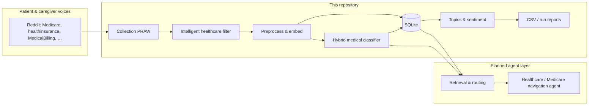

# Healthcare navigation agent — foundation (Reddit intelligence pipeline)

This repository is the **first layer** of an AI agent meant to help people **navigate U.S. healthcare and Medicare**: coverage rules, denials and appeals, billing, plan choices, and the bureaucratic maze patients describe every day.

What lives here today is **not** the conversational agent itself. It is the **data and NLP pipeline** that:

- Listens where people already ask for help (Reddit communities around insurance, Medicare, Medicaid, billing, and patient experience)
- Filters and prioritizes posts that mirror real navigation problems (denials, prior auth, network issues, “what do I do next?”)
- Stores, embeds, clusters, and labels that language so downstream retrieval, routing, and training can use it

The long-term goal is an agent that can **classify intent**, **surface similar resolved situations**, and eventually **guide users** through Medicare Advantage vs. Original Medicare, enrollment windows, appeals, and employer vs. public coverage—with guardrails and citations, not generic chat.

---

## Vision: from community questions to a navigation agent

| Stage | Role |
| --- | --- |
| **Now (this repo)** | Collect and structure healthcare-related discourse; tag topics and categories; build a searchable corpus (SQLite + embeddings + exports). |
| **Next** | Retrieval over labeled posts/comments; intent routing by category (insurance vs. provider vs. policy); RAG over curated answers. |
| **Later** | Multi-step agent workflows (e.g. “claim denied → appeal checklist → plan/network check”) with human-in-the-loop and clear disclaimers. |



**Design choices aligned with navigation, not generic social listening**

- Default subreddits span **Medicare**, **Medicaid**, **health insurance**, **medical billing**, **patient experience**, and related communities (`config.py`).
- **Intelligent filtering** boosts content about claim denials, coverage friction, troubleshooting, and first-person experiences (`src/data_collection/intelligent_filter.py`).
- **Medical category classification** routes text into insurance, providers, brokers, employer benefits, and policy/legislation buckets—useful for steering an agent’s tools and tone. See [CLASSIFICATION_GUIDE.md](CLASSIFICATION_GUIDE.md).

---

## Tech stack

| Layer | Technologies |
| --- | --- |
| **Ingestion** | [PRAW](https://praw.readthedocs.io/) (Reddit API), optional noise filtering |
| **Storage** | SQLite (`src/database/`) |
| **NLP / embeddings** | [Sentence Transformers](https://www.sbert.net/), [spaCy](https://spacy.io/), [NLTK](https://www.nltk.org/) |
| **Clustering** | HDBSCAN, scikit-learn |
| **Topic modeling** | Gensim LDA, sklearn LDA/NMF; optional BERTopic |
| **Sentiment** | VADER or transformer-based analyzers (`src/sentiment/`) |
| **Classification** | Rule-based + ML + **hybrid** (`src/classification/`), embedding-similarity helpers |
| **Analysis & viz** | pandas, matplotlib, seaborn, plotly |
| **Runtime** | Python ≥ 3.8; PyTorch / `transformers` for optional deep models |

Package name in `pyproject.toml`: `reddit-analysis-pipeline` (console entry: `reddit-pipeline` → `pipeline:main`). Modules live under `src/` as top-level imports (`pipeline`, `classification`, …).

---

## Installation

This package is **not** published as a verified PyPI distribution in this repo’s workflow. Install from source:

```bash
git clone https://github.com/justinlandess/reddit.git
cd reddit
pip install -e .
# or: pip install -r requirements.txt
```

Prefer running scripts from the **repository root** (they add `src/` to `sys.path`).

---

## Setup

Create a `.env` in the repo root:

```bash
REDDIT_CLIENT_ID=your_client_id_here
REDDIT_CLIENT_SECRET=your_client_secret_here
REDDIT_USER_AGENT=RedditAnalysisBot/1.0
```

Focus collection on Medicare and adjacent communities:

```bash
export SUBREDDITS="healthinsurance,Medicare,Medicaid,MedicalBilling,PatientExperience"
export PRIORITIZE_HEALTHCARE=true
export INTELLIGENT_FILTERING=true
```

Full options are documented in `config.py` (limits, embeddings, clustering, historical tracking, classification).

---

## Usage

### Main entry points

```bash
python main.py
python main.py --analyzer transformer
python main.py --log-level DEBUG
```

### Python API

```python
from pipeline import RedditAnalysisPipeline

pipeline = RedditAnalysisPipeline(analyzer_type='vader')
pipeline.run_full_pipeline()
```

### Utilities

```bash
python export_to_csv.py
python run_topic_analysis.py
python collect_to_50k.py
python analyze_existing_data.py --analyzer vader
python example_classification.py
python organize_outputs.py
```

For medical-category classifiers (`RuleBasedClassifier`, `MLClassifier`, `HybridClassifier`, embedding-similarity), see **[CLASSIFICATION_GUIDE.md](CLASSIFICATION_GUIDE.md)**.

### Scripts referenced elsewhere but not in repo

- `sentiment_sandbox.py`
- `analyze_convexity.py`

---

## What the pipeline does (feature summary)

- Reddit API collection with healthcare-aware filtering
- Text cleaning, Sentence Transformer embeddings, SQLite persistence
- HDBSCAN / k-means clustering and subreddit-level analysis
- Topic modeling and optional sentiment (VADER or transformer)
- **Hybrid medical classification** for agent routing and analytics
- CSV exports, historical run tracking under `historical_runs/`, visualizations

---

## Project structure

```
reddit/
├── main.py
├── config.py
├── pyproject.toml
├── requirements.txt
├── CLASSIFICATION_GUIDE.md
├── example_classification.py
├── export_to_csv.py
├── run_topic_analysis.py
├── collect_to_50k.py
├── analyze_existing_data.py
└── src/
    ├── pipeline.py
    ├── data_collection/
    ├── preprocessing/
    ├── embeddings/
    ├── database/
    ├── clustering/
    ├── analysis/
    ├── sentiment/
    ├── classification/
    ├── topic_modeling/
    └── tracking/
```

---

## Disclaimer

This project is for **research and product development** on how people talk about healthcare and Medicare online. It is **not** medical, legal, or insurance advice. Any future agent must enforce clear boundaries, escalate to licensed professionals when appropriate, and comply with Reddit’s API terms and community rules.

## License

Educational and research use. Respect Reddit’s API terms and community norms.